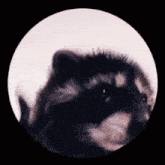

# Pedro the Raccoon – Glyph Toy

  

A Glyph Toy for the **Nothing Phone (3)** that loops a dancing Pedro on the Glyph Matrix.
It also plays when the phone rings.

## Install
1. Download `pedro-glyph-toy.apk` from [Releases](../../releases) and install it.
2. Open the app and tap **Add to Glyph Toys**.
3. Tap **Allow call detection** if you want Pedro on incoming calls.

Needs Nothing OS 4.0 or later.

## Note
Nothing's built-in ringtones have their own Glyph pattern that overrides apps.
If Pedro doesn't show while ringing, pick a different ringtone.

## Build
Open in Android Studio and press **Run**, or run `./gradlew assembleRelease`.

## License
MIT. The Glyph Matrix SDK in `app/libs/` belongs to [Nothing](https://github.com/Nothing-Developer-Programme/GlyphMatrix-Developer-Kit).
